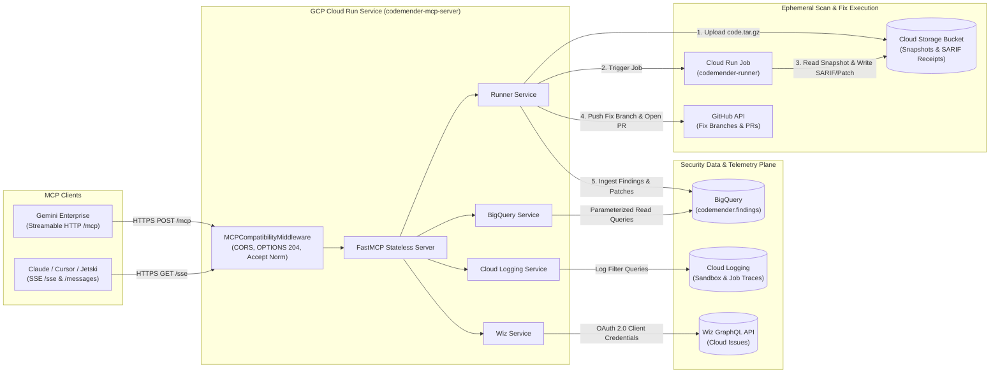

# Code Mender Security MCP Server — Deployment & Testing Guide

This guide provides step-by-step instructions to deploy, configure, and validate the **Code Mender Security MCP Server** on **Google Cloud Run**, connect it to **BigQuery**, **Cloud Logging**, **Cloud Run Jobs**, and **Wiz**, and integrate it with **Gemini Enterprise**, **Claude Desktop**, **Cursor**, or **Jetski**.

---

## 1. Architecture & Execution Flow



### Capabilities Overview (18 Tools)

| Category | Tools | Purpose |
| :--- | :--- | :--- |
| **Code Mender Execution (Find & Fix)** | `cm_find`, `cm_validate`, `cm_fix`, `cm_apply_patch`, `cm_job_status`, `cm_list_findings`, `cm_get_finding` | Clone repositories, dispatch isolated Cloud Run Jobs to find vulnerabilities, verify exploitability, generate unified diff patches, ingest into BigQuery, and open GitHub PRs. |
| **BigQuery Findings & Analytics** | `list_codemender_issues`, `get_issue_details`, `get_issues_summary`, `get_bigquery_schema`, `query_codemender_bigquery` | Filter findings by severity/CWE/repo, inspect remediation patches, compute executive summaries, and run read-only SQL queries. |
| **Cloud Logging Diagnostics** | `get_issue_logs`, `search_codemender_logs` | Correlate finding IDs and session IDs with compiler outputs, sandbox violations, and execution trace logs. |
| **Wiz Cloud Security** | `list_wiz_issues`, `get_wiz_issue_details`, `get_wiz_issues_summary`, `query_wiz_graphql` | Query cloud posture issues, toxic combinations, and threat detections alongside code vulnerabilities. |

---

## 2. Prerequisites

Before deploying, ensure you have:
1. **Google Cloud SDK (`gcloud`)** and **`bq` CLI** installed and authenticated.
2. **A GCP Project** with billing enabled.
3. **IAM Permissions** for the deploying administrator:
   - `roles/run.admin`
   - `roles/iam.serviceAccountAdmin`
   - `roles/resourcemanager.projectIamAdmin`
   - `roles/cloudbuild.builds.editor`
   - `roles/secretmanager.admin` (if using `GITHUB_TOKEN` or Wiz credentials)
   - `roles/bigquery.admin`
   - `roles/storage.admin`
4. **Optional Credentials**:
   - **GitHub Personal Access Token (`GITHUB_TOKEN`)**: Classic token with `repo` scope (or fine-grained token with `Contents: Read & Write` and `Pull requests: Read & Write`) to allow `cm_fix` to push branches and open PRs.
   - **Wiz Service Account (`WIZ_CLIENT_ID`, `WIZ_CLIENT_SECRET`, `WIZ_API_ENDPOINT`)**: With `read:issues` scope for Wiz tools.

---

## 3. Environment Preparation

### Step 3.1: Clone the Repository
```bash
git clone https://github.com/avnit/codemender-mcp.git
cd codemender-mcp
```

### Step 3.2: Set Your GCP Project and Region
```bash
export PROJECT_ID="your-gcp-project-id"
export REGION="us-central1"

gcloud config set project "${PROJECT_ID}"
gcloud config set run/region "${REGION}"
```

### Step 3.3: Create BigQuery Dataset & GCS Transit Bucket
The server automatically creates and migrates the `findings` and `jobs` tables inside BigQuery on startup, provided the dataset exists:
```bash
# 1. Create the BigQuery dataset
bq --location=US mk -d "${PROJECT_ID}:codemender" || true

# 2. Create the GCS transit bucket for code snapshots and SARIF artifacts
gcloud storage buckets create "gs://codemender-reports-${PROJECT_ID}" \
  --project="${PROJECT_ID}" \
  --location="${REGION}" \
  --uniform-bucket-level-access || true
```

### Step 3.4: Configure `.env`
Copy the template and populate your environment values:
```bash
cp .env.example .env
```

Edit `.env`:
```ini
# --- Google Cloud ---
GCP_PROJECT_ID=your-gcp-project-id
REGION=us-central1
SERVICE_NAME=codemender-mcp-server

# --- BigQuery (Code Mender findings) ---
BQ_DATASET=codemender
BQ_TABLE=findings

# --- Cloud Logging ---
LOG_NAME_FILTER=codemender

# --- Code Mender Execution Runner ---
CM_RUNNER_JOB_NAME=codemender-runner
CM_REPORTS_BUCKET=codemender-reports-your-gcp-project-id
CM_DEFAULT_PATCH_MODE=pr
GITHUB_TOKEN=ghp_your_github_token_here
GITHUB_API_URL=https://api.github.com
GIT_AUTHOR_NAME=CodeMender
GIT_AUTHOR_EMAIL=codemender-bot@users.noreply.github.com

# --- Wiz (Optional - leave blank if not using Wiz) ---
WIZ_CLIENT_ID=
WIZ_CLIENT_SECRET=
WIZ_API_ENDPOINT=https://api.us17.app.wiz.io/graphql
```

---

## 4. Deploying to Google Cloud Run

### Option A: Automated Turnkey Deployment (Recommended)

Run the included deployment script, which reads `.env`, enables APIs, provisions the `codemender-mcp-sa` service account with least-privilege IAM roles, stores secrets in Secret Manager, re-enables the Cloud Build service account if disabled, and deploys the service:

```bash
./deploy_cloud_run.sh -p "${PROJECT_ID}" -r "${REGION}"
```

> [!TIP]
> If you are connecting from a client that does not inject GCP IAM identity tokens (or during initial sandbox testing in Gemini Enterprise), you can pass `--allow-unauthenticated`:
> ```bash
> ./deploy_cloud_run.sh -p "${PROJECT_ID}" -r "${REGION}" --allow-unauthenticated
> ```

### Option B: Deploying the `codemender-runner` Cloud Run Job

To execute live scans (`cm_find`), exploitability checks (`cm_validate`), and patch generation (`cm_fix`), the MCP server triggers a Cloud Run Job named `codemender-runner`.

If the `codemender-runner` job is not yet deployed in your project, deploy it from the [codemender-runner-mcp](https://github.com/avnit/codemender-runner-mcp) repository:
```bash
# In Google Cloud Shell, install real Terraform first (Cloud Shell ships a stub at /usr/local/bin/terraform that exits 0 without running Terraform):
if ! terraform version 2>/dev/null | grep -q "Terraform v"; then
  wget -O - https://apt.releases.hashicorp.com/gpg | sudo gpg --dearmor -o /usr/share/keyrings/hashicorp-archive-keyring.gpg
  echo "deb [arch=$(dpkg --print-architecture) signed-by=/usr/share/keyrings/hashicorp-archive-keyring.gpg] https://apt.releases.hashicorp.com $(grep -oP '(?<=UBUNTU_CODENAME=).*' /etc/os-release || lsb_release -cs) main" | sudo tee /etc/apt/sources.list.d/hashicorp.list
  sudo apt update && sudo apt install -y terraform
fi

git clone https://github.com/avnit/codemender-runner-mcp.git
cd codemender-runner-mcp
./deploy.sh --project "${PROJECT_ID}" --region "${REGION}" --github-owner "<YOUR_GITHUB_USERNAME_OR_ORG>"
```

---

## 5. Verification & Testing Runbook

Once deployed, run the following verification suite to confirm every layer of the stack is working properly.

### Step 5.1: Export Service URL & Identity Token
```bash
export SERVICE_URL=$(gcloud run services describe codemender-mcp-server \
  --region="${REGION}" \
  --project="${PROJECT_ID}" \
  --format='value(status.url)')

export TOKEN=$(gcloud auth print-identity-token)

echo "Service URL: ${SERVICE_URL}"
```

### Step 5.2: Verify Health & Service Metadata
```bash
# 1. Health probe (/healthz)
curl -s -H "Authorization: Bearer ${TOKEN}" "${SERVICE_URL}/healthz" | jq

# Expected output:
# {
#   "status": "healthy",
#   "service": "codemender-mcp-server",
#   "project": "your-gcp-project-id",
#   "dataset": "codemender",
#   "table": "findings",
#   "wiz_configured": false,
#   "runner_configured": true
# }

# 2. Service & Tool Registry metadata (/)
curl -s -H "Authorization: Bearer ${TOKEN}" "${SERVICE_URL}/" | jq
```

### Step 5.3: Verify Gemini Enterprise HTTP Transport Compatibility
Gemini Enterprise and browser-based MCP gateways send `OPTIONS` preflight, `HEAD` probes, `DELETE` session-termination requests, and `Accept: application/json` headers. Verify none return `405 Method Not Allowed` or `406 Not Acceptable`:

```bash
# Test OPTIONS preflight (Expect HTTP 204)
curl -i -s -X OPTIONS "${SERVICE_URL}/mcp" | head -n 5

# Test DELETE session termination (Expect HTTP 200)
curl -s -X DELETE -H "Authorization: Bearer ${TOKEN}" "${SERVICE_URL}/mcp" | jq

# Test MCP Initialize handshake over /mcp (Expect HTTP 200)
curl -s -X POST "${SERVICE_URL}/mcp" \
  -H "Authorization: Bearer ${TOKEN}" \
  -H "Content-Type: application/json" \
  -H "Accept: application/json" \
  -d '{
    "jsonrpc": "2.0",
    "id": 1,
    "method": "initialize",
    "params": {
      "protocolVersion": "2024-11-05",
      "capabilities": {},
      "clientInfo": {"name": "test-client", "version": "1.0"}
    }
  }'
```

### Step 5.4: List All Registered MCP Tools (`tools/list`)
```bash
curl -s -X POST "${SERVICE_URL}/mcp" \
  -H "Authorization: Bearer ${TOKEN}" \
  -H "Content-Type: application/json" \
  -H "Accept: application/json" \
  -d '{
    "jsonrpc": "2.0",
    "id": 2,
    "method": "tools/list",
    "params": {}
  }' | grep -o '"name":"[^"]*"'
```

### Step 5.5: Test BigQuery Findings & Negative Security Guardrails
```bash
# 1. Get Summary of Findings
curl -s -X POST "${SERVICE_URL}/mcp" \
  -H "Authorization: Bearer ${TOKEN}" \
  -H "Content-Type: application/json" \
  -H "Accept: application/json" \
  -d '{
    "jsonrpc": "2.0",
    "id": 3,
    "method": "tools/call",
    "params": {
      "name": "get_issues_summary",
      "arguments": {}
    }
  }'

# 2. Negative Security Test: Verify destructive SQL is blocked
curl -s -X POST "${SERVICE_URL}/mcp" \
  -H "Authorization: Bearer ${TOKEN}" \
  -H "Content-Type: application/json" \
  -H "Accept: application/json" \
  -d '{
    "jsonrpc": "2.0",
    "id": 4,
    "method": "tools/call",
    "params": {
      "name": "query_codemender_bigquery",
      "arguments": {
        "sql_query": "DROP TABLE `codemender.findings`"
      }
    }
  }'
# Expected: {"error": "Only read-only SELECT or WITH queries are allowed."}
```

### Step 5.6: Test End-to-End Scan, Validation & Fix (`cm_find` -> `cm_fix`)
```bash
# 1. Start a repository scan
curl -s -X POST "${SERVICE_URL}/mcp" \
  -H "Authorization: Bearer ${TOKEN}" \
  -H "Content-Type: application/json" \
  -H "Accept: application/json" \
  -d '{
    "jsonrpc": "2.0",
    "id": 5,
    "method": "tools/call",
    "params": {
      "name": "cm_find",
      "arguments": {
        "repo": "owner/repository-name",
        "ref": "main",
        "wait_seconds": 0
      }
    }
  }'

# 2. Poll the job status using the returned job_id
curl -s -X POST "${SERVICE_URL}/mcp" \
  -H "Authorization: Bearer ${TOKEN}" \
  -H "Content-Type: application/json" \
  -H "Accept: application/json" \
  -d '{
    "jsonrpc": "2.0",
    "id": 6,
    "method": "tools/call",
    "params": {
      "name": "cm_job_status",
      "arguments": {
        "job_id": "find-xxxxxxxxxxxx",
        "wait_seconds": 30
      }
    }
  }'

# 3. List ingested findings in BigQuery
curl -s -X POST "${SERVICE_URL}/mcp" \
  -H "Authorization: Bearer ${TOKEN}" \
  -H "Content-Type: application/json" \
  -H "Accept: application/json" \
  -d '{
    "jsonrpc": "2.0",
    "id": 7,
    "method": "tools/call",
    "params": {
      "name": "cm_list_findings",
      "arguments": {
        "repo": "owner/repository-name",
        "limit": 20
      }
    }
  }'

# 4. Generate a patch & open a GitHub PR for a finding
curl -s -X POST "${SERVICE_URL}/mcp" \
  -H "Authorization: Bearer ${TOKEN}" \
  -H "Content-Type: application/json" \
  -H "Accept: application/json" \
  -d '{
    "jsonrpc": "2.0",
    "id": 8,
    "method": "tools/call",
    "params": {
      "name": "cm_fix",
      "arguments": {
        "finding_id": "<FINDING_ID>",
        "patch_mode": "pr",
        "wait_seconds": 60
      }
    }
  }'
```

---

## 6. Connecting MCP Clients

### A. Gemini Enterprise (Google Cloud Agent Builder)
When registering the custom MCP Action in Gemini Enterprise:
- **Server URL**: `https://<YOUR_CLOUD_RUN_SERVICE_URL>/mcp` (or `https://<YOUR_CLOUD_RUN_SERVICE_URL>/`)
- **Transport**: Streamable HTTP
- **Authentication**:
  - If deployed with `--allow-unauthenticated`: Select **No Authentication** (or Bearer Token if behind an authenticating proxy).
  - If deployed with IAM authentication: Configure OIDC / Service Account token authentication and grant `roles/run.invoker` to the Gemini Enterprise service agent.

### B. Claude Desktop / Cursor / Jetski (Direct HTTPS)
Add the following to your `mcp.json` or `claude_desktop_config.json`:
```json
{
  "mcpServers": {
    "codemender": {
      "url": "https://<YOUR_CLOUD_RUN_SERVICE_URL>/sse",
      "headers": {
        "Authorization": "Bearer <YOUR_GCLOUD_IDENTITY_TOKEN>"
      }
    }
  }
}
```

### C. Local Proxy Mode (Automatic IAM Token Refresh)
To avoid manually refreshing short-lived `gcloud` identity tokens locally, run the Cloud Run local proxy:
```bash
gcloud run services proxy codemender-mcp-server \
  --region="${REGION}" \
  --project="${PROJECT_ID}" \
  --port=8080
```
Then point your local MCP client to `http://localhost:8080/sse` (or `http://localhost:8080/mcp`) with no `Authorization` header required.

---

## 7. Running Local Development & Unit Tests

To run the test suite locally (295 unit tests covering SARIF parsing, git snapshotting, BigQuery store, Wiz client, and FastMCP HTTP routes):

```bash
python3 -m venv .venv
source .venv/bin/activate
pip install -r requirements.txt
pip install pytest httpx

# Run all tests
pytest -v

# Run only MCP server & HTTP endpoint tests
pytest -v tests/test_server.py
```

---

## 8. Troubleshooting Common Issues

| Symptom / Error | Root Cause | Resolution |
| :--- | :--- | :--- |
| `ERROR: (gcloud.run.deploy) Could not build the function due to disabled service account ...-compute@developer.gserviceaccount.com` | The Default Compute Engine Service Account used by Cloud Build is disabled in the project. | `./deploy_cloud_run.sh` automatically re-enables it, or run:<br>`gcloud iam service-accounts enable <PROJECT_NUMBER>-compute@developer.gserviceaccount.com` |
| `ModuleNotFoundError: No module named 'mcp.server.fastmcp'` | `mcp` SDK 2.x was installed instead of 1.x. | Ensure `requirements.txt` pins `mcp>=1.2.0,<2.0.0`. |
| `Client error '405 Method Not Allowed'` or `Session terminated` in Gemini Enterprise | Client sends `OPTIONS`, `DELETE`, or `POST` to `/sse` or `/mcp`. | Resolved by `MCPCompatibilityMiddleware` and multi-transport routing in `server.py`. Ensure you are running the latest `main` branch. |
| `cm_find` returns `CodeMender execution service unavailable` or `404 Job not found` | The `codemender-runner` Cloud Run Job has not been created in the target project/region. | Verify `CM_RUNNER_JOB_NAME` in `.env` and deploy the runner job (`gcloud run jobs list --region=us-central1`). |
