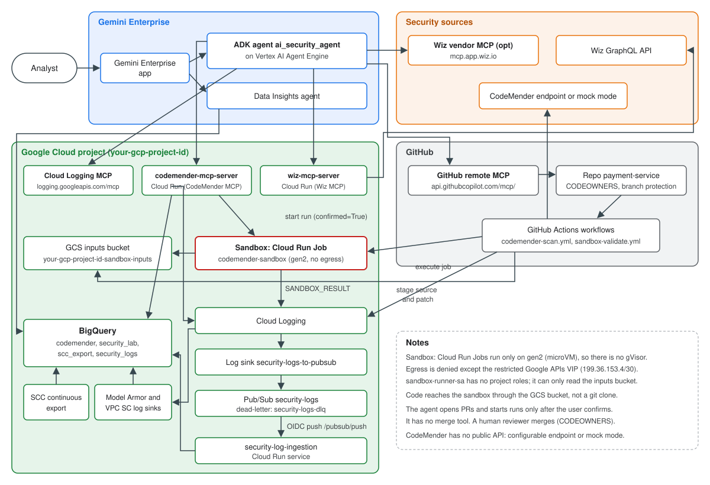
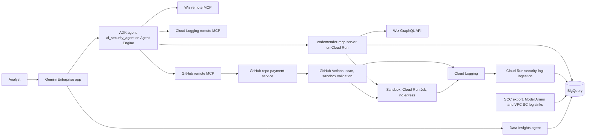

# AI Security Agent Lab (branch: `ai-security-agent-lab`)

This branch turns the Code Mender MCP server into a 4-hour hands-on lab. Participants build an AI security agent on Gemini Enterprise that pulls from Wiz, Cloud Logging, GitHub, CodeMender, and BigQuery. They use it to triage alerts, investigate cloud security questions, and fix vulnerable code with a human approving every change.

The original MCP server is still here, in `mcp-server/`, with new tools added. It is one of the four MCP servers the agent uses.

> **Status: build complete, not yet run live.** All code, tests, lab modules, starter files, the facilitator guide and the PDFs are in this commit. See [Branch status](#branch-status) for what still needs a live environment to confirm.

## What participants build

An ADK agent (`ai_security_agent`) deployed to Vertex AI Agent Engine and registered in Gemini Enterprise. It connects to four MCP servers:

| MCP server | Used for |
|---|---|
| Wiz remote MCP (`mcp.app.wiz.io`) | Issues, vulnerabilities, cloud graph |
| Cloud Logging remote MCP (`logging.googleapis.com/mcp`) | Log entries from scans, sandbox runs, services |
| GitHub remote MCP (`api.githubcopilot.com/mcp`) | Repo code, workflow runs, pull requests |
| `codemender-mcp-server` (this repo, Cloud Run) | BigQuery findings, SCC / Model Armor / VPC SC data, code-to-cloud mapping, sandbox runs |

The agent is used for two jobs:

1. **Conversational investigation.** Questions that need several sources, such as "What are our top 5 critical internet-facing vulnerabilities in production?" or "Which service accounts in the payment service have excessive permissions?" The agent answers in plain language. It traces a runtime vulnerability back to the Git repo, base image, or Terraform file it came from.
2. **Code remediation with a human in the loop.** The agent takes a Wiz or CodeMender finding, finds the vulnerable code, and writes a small patch. It tests the patch in an isolated sandbox, then opens a pull request with a security justification. A person reviews and merges it. The agent has no merge tool.

## Architecture





## Repository layout

| Directory | Contents |
|---|---|
| `lab/` | Lab guide modules 00-08, troubleshooting, cleanup, facilitator guide, architecture image |
| `mcp-server/` | The custom MCP server (moved from the repo root), with new investigation, code-to-cloud, BigQuery, and sandbox tools |
| `agent/` | ADK agent package, deploy script for Agent Engine, Gemini Enterprise registration steps |
| `agent/skills/` | Seven skills: alert triage, investigation routing, code-to-cloud attribution, root cause and patch, sandbox verification, PR creation, BigQuery / Data Insights |
| `log-ingestion/` | Cloud Run service: Cloud Logging, then Pub/Sub, then BigQuery, using a prepared schema |
| `sandbox/` | Cloud Run Job that applies a patch and runs the PoC and unit tests with no internet access |
| `sample-app/` | `payment-service`, an intentionally vulnerable Flask app, with GitHub workflows, patches, and benign PoC tests |
| `infra/terraform/` | All GCP resources: BigQuery, Pub/Sub, log sinks, Cloud Run, VPC, Secret Manager, Workload Identity Federation, IAM |
| `seed-data/` | Sample findings, events, and logs, plus a loader, so every module works without live findings |
| `starter/` | Participant versions of selected files with TODOs to complete |
| `pdf/` | Participant guide and facilitator guide as PDFs, rendered from the Markdown (order in `lab/PDF-ORDER.txt`) |

## Moved files

The server files that used to be at the repo root (`server.py`, `config.py`, `services/`, `tests/`, `Dockerfile`, `requirements.txt`, `deploy_cloud_run.sh`, `deploy.sh`, `cloudbuild.yaml`, `.env.example`, `.dockerignore`) now live in `mcp-server/`. Run the server's commands from that folder:

```bash
cd mcp-server
cp .env.example .env      # set GCP and Wiz values
./deploy_cloud_run.sh
```

## Prerequisites (from Days 1-3)

- A GCP project with billing, and Owner or the roles listed in [lab/00-overview.md](lab/00-overview.md).
- A Wiz tenant with a connected cloud account, and a Wiz admin who can enable the remote MCP server.
- A GitHub org where you can create the private `payment-service` repo and set branch protection.
- A Gemini Enterprise app in the same project, and a Gemini Enterprise admin.
- Local tools: `gcloud`, `terraform`, `git`, `gh`, Python 3.11 or later.

## Quick start

1. **Environment.** Create `lab.env` in the repo root using the cheat sheet in [lab/00-overview.md](lab/00-overview.md#environment-variables-cheat-sheet), then run `source lab.env`. The file is git-ignored.
2. **Infrastructure.** Apply Terraform in two phases. The steps are in [infra/terraform/README.md](infra/terraform/README.md).

   ```bash
   cd infra/terraform
   # edit project_id, region, github_org, participant_members
   cp terraform.tfvars.example terraform.tfvars
   terraform init
   terraform apply -target=<phase-1 targets from infra/terraform/README.md>
   terraform apply
   cd ../..
   ```

3. **Seed data.**

   ```bash
   python3 seed-data/load_seed_data.py
   ```

4. **Services.**

   ```bash
   (cd mcp-server && ./deploy_cloud_run.sh)
   (cd log-ingestion && ./deploy.sh)
   (cd sandbox && ./deploy.sh)
   ```

5. **Agent, locally.**

   ```bash
   cd agent
   cp .env.example .env    # set GOOGLE_CLOUD_PROJECT, CODEMENDER_MCP_URL, GITHUB_ORG, and the rest
   pip install google-adk
   adk web
   ```

   Open http://localhost:8000 and select `security_agent`.

## Lab modules

The lab runs 4 hours, including setup checks and breaks. Participants spend most of the hands-on time connecting the MCP servers to Gemini Enterprise, wiring the agent, writing tools and skills, and running the exercises. The sandbox, log ingestion, and Terraform are pre-built: participants deploy and verify them.

| # | Module |
|---|---|
| 00 | [Overview, objectives, prerequisites](lab/00-overview.md) |
| 01 | [Wiz remote MCP and Gemini Enterprise auth](lab/01-wiz-remote-mcp.md) |
| 02 | [Cloud Logging remote MCP](lab/02-cloud-logging-remote-mcp.md) |
| 03 | [GitHub remote MCP and CI/CD](lab/03-github-remote-mcp.md) |
| 04 | [Validation sandbox](lab/04-validation-sandbox.md) |
| 05 | [Log ingestion](lab/05-log-ingestion.md) |
| 06 | [Data Insights agent on BigQuery](lab/06-data-insights-bigquery.md) |
| 07 | [Tools and skills](lab/07-tools-and-skills.md) |
| 08 | [Capability exercises](lab/08-capability-exercises.md) |
| | [Troubleshooting](lab/troubleshooting.md), [Cleanup](lab/cleanup.md) |

## Branch status

**In this commit**

| Part | Tests |
|---|---|
| `mcp-server/` | 68 unit tests pass: 21 original, 47 new |
| `log-ingestion/` | 74 unit tests pass |
| `sandbox/` | 38 unit tests pass |
| `seed-data/` | 28 unit tests pass |
| `agent/` and skills | 51 unit tests pass (offline, no model calls) |
| `sample-app/` app, PoC tests, patches | 8 tests pass, 7 Flask tests skipped (Flask was not installed in the build environment). With both reference patches applied, the unit tests pass and both PoC tests fail, as intended. |
| `sample-app/` workflows | YAML parses; not run on a GitHub runner |
| `infra/terraform/` | Not validated: Terraform was not installed in the build environment |
| `lab/` modules 00-08, troubleshooting, cleanup | Done, timed for 4 hours |
| `lab/facilitator-guide.md` | Done: schedule, pre-deploy list, expected outputs, answer keys, reset steps |
| `starter/` | Done: 5 files with TODOs |
| `pdf/` | Participant guide and facilitator guide PDFs, rendered from the Markdown in the order listed in `lab/PDF-ORDER.txt` |

The new `mcp-server` tools are two Wiz investigation tools (`wiz_top_internet_facing_vulnerabilities`, `wiz_excessive_permission_identities`), code-to-cloud tracing (`trace_code_to_cloud`), four BigQuery queries (`query_scc_findings`, `query_model_armor_logs`, `query_vpcsc_violations`, `query_security_events`), and a sandbox pair (`start_sandbox_validation`, `get_sandbox_result`). `start_sandbox_validation` does nothing unless it is called with `confirmed=True`.

The line numbers in `sample-app/.codemender/mock-findings.json` are fixed and match the app code.

All Python files parse, all shell scripts pass `bash -n`, and a scan found no credentials. Every secret in the repo is a placeholder.

`log-ingestion`, `sandbox`, `seed-data` and `agent` tests all pass offline. The unit tests used mocks and stubbed modules, because the build environment could not install all dependencies. Nothing here has run against a live Wiz tenant, GCP project, or GitHub org yet.

**Needs a live environment to confirm**

Wiz

- Remote MCP enablement path (Settings > Tenant > AI Features), the toggle label, and which auth methods are supported.
- All Wiz GraphQL fields used by the new tools. Each is marked "verify against your tenant's schema" in `mcp-server/services/wiz_service.py` and listed in `mcp-server/README.md`: `vulnerabilityFindings` filters and exposure fields, `graphSearch` privilege filters, and `cloudResources` image and repository fields.
- How the agent authenticates to Wiz MCP: the header format, and exchanging the client ID and secret for a token.
- Whether Wiz MCP can be added directly as a Gemini Enterprise custom MCP connector.

Google Cloud / Gemini Enterprise

- Cloud Logging remote MCP enablement command, and whether it needs an IAM role beyond `roles/logging.viewer`. Cloud Logging and GitHub remote MCP authentication from Gemini Enterprise.
- Gemini Enterprise custom MCP connector and OAuth setup. UI paths and labels for the custom MCP connector, Data Insights agent, Agent Engine registration and Agent Designer, and whether native ADK confirmation shows as approve/reject in Gemini Enterprise.
- Whether the connector needs scopes beyond `openid email profile`.
- The API name `geminidataanalytics.googleapis.com` and the role `roles/geminidataanalytics.dataAgentUser`.
- The Model Armor log name, sink filter and `jsonPayload` field names, and the exact sink table names in `security_logs`.
- SCC BigQuery export: the Terraform resource type for provider v6, org-level permissions, whether the export writes into the pre-created table, and the export's real schema.
- Whether the Agent Engine and Discovery Engine service agents exist before first use (if not, re-apply Terraform afterwards).

First full runs

- Terraform apply, Cloud Run deploys, and the sandbox job on gen2 with egress blocked.
- Whether callers that only run the job need `iam.serviceAccountUser` on `sandbox-runner-sa` (Terraform grants it to be safe).
- `get_sandbox_result` lookup by `run_id`, which depends on Cloud Run returning env overrides on executions.
- `gcloud run jobs execute --wait --format='value(metadata.name)'` returning the execution name.
- The egress check (`sandbox/egress-check`) gives `POC_NOT_REPRODUCED` on the real job.
- The image builds. The sandbox image bakes in Flask and pytest because there is no egress at runtime.

GitHub

- The GitHub MCP tool names used in docs and guardrails (`get_file_contents`, `create_pull_request`, `run_workflow`, `merge_pull_request`, ...) and the `X-MCP-Toolsets` / `X-MCP-Readonly` headers.
- Fine-grained PAT scopes, SSO authorization, and that branch protection or rulesets block a merge by the agent's token.
- GitHub Actions with Workload Identity Federation: end-to-end runs of `codemender-scan.yml` (mock mode) and `sandbox-validate.yml` (both `patch_path` and `branch` inputs).

## Design notes

- **No gVisor.** Cloud Run Jobs run only on the second-generation execution environment, so gVisor is not available. The sandbox relies on the gen2 microVM, an egress-denied VPC, and a service account with no project roles. If you need gVisor, use GKE Sandbox.
- **Code reaches the sandbox through a storage bucket.** The sandbox has no egress, so it cannot clone from GitHub. Source tarballs and patches are staged in `gs://<project>-sandbox-inputs` and read through Private Google Access.
- **Agent-written fixes go through a branch and a workflow.** The agent pushes its fix to a `security/...` branch and then dispatches `sandbox-validate.yml`. It asks for confirmation before each step. `start_sandbox_validation` is for patches that are already staged.
- **CodeMender is a configurable endpoint.** Set `CODEMENDER_API_URL` and `CODEMENDER_API_TOKEN` to use a real endpoint. Without them, the scan runs in mock mode and emits the seed findings.

## Safety notes

- `sample-app/` is intentionally vulnerable: SQL injection (CWE-89), path traversal (CWE-22), a service account with `roles/editor`, and an end-of-life base image. Keep the `payment-service` repo private and do not deploy the app to a public endpoint. The PoC tests are local-only. The traversal target is a dummy file, `sample-app/data/not_a_secret.txt`.
- The sandbox runs as a Cloud Run Job on the second-generation execution environment, because Cloud Run Jobs do not support the first-generation gVisor environment. The VPC denies all egress except the restricted Google APIs range. The job's service account has no project roles, only read access to the sandbox inputs bucket.
- The agent opens pull requests and starts workflows only after the user confirms. It cannot merge. Branch protection and CODEOWNERS require one human approval.

## About CodeMender

CodeMender (Google DeepMind) has no public API. The scan workflow calls an HTTP endpoint you configure with `CODEMENDER_API_URL` and `CODEMENDER_API_TOKEN`. If those are not set, it runs in mock mode and emits the seed findings `CM-0001` to `CM-0004` from `sample-app/.codemender/mock-findings.json`. Everything downstream (logs, ingestion, BigQuery, agent) works the same either way.
