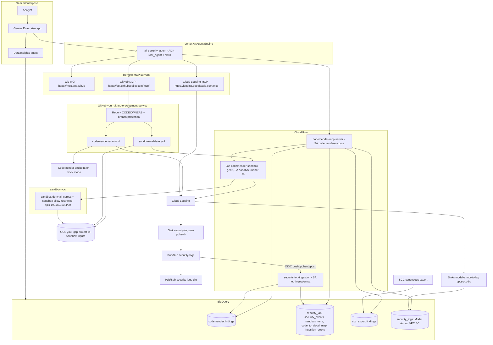
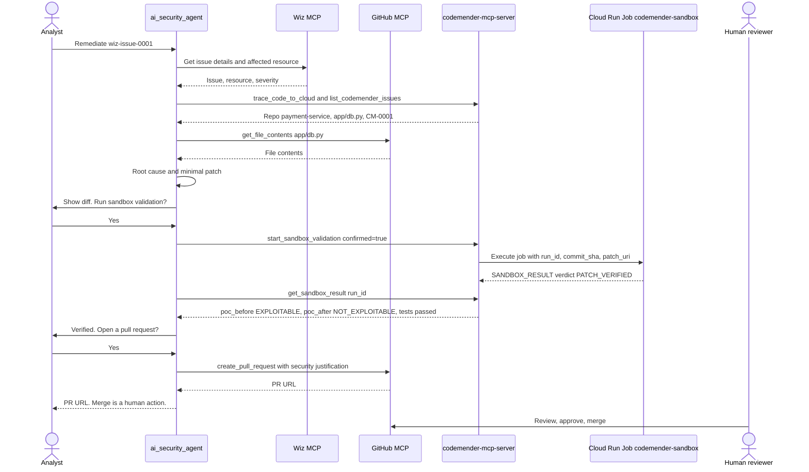

# 00 - Overview

**Goal:** Understand what you will build today and set up the environment variables every later module uses.

**Time:** 15 minutes

**Prerequisites:** The Day 1-3 environment (below). `gcloud`, `terraform`, `git`, `gh`, and Python 3.11 or later installed locally.

## Objectives

By the end of the day you will have:

1. Connected the Wiz, Cloud Logging, and GitHub remote MCP servers to an ADK agent, and seen how each one authenticates with Gemini Enterprise.
2. Deployed the custom MCP server `codemender-mcp-server` on Cloud Run. It reads BigQuery, queries Wiz GraphQL, and starts sandbox runs.
3. Deployed a validation sandbox: the Cloud Run Job `codemender-sandbox`, with no egress and no permissions.
4. Built a log pipeline: Cloud Logging, then the sink `security-logs-to-pubsub`, then Pub/Sub `security-logs`, then `security-log-ingestion`, then BigQuery.
5. Queried the security datasets with the Data Insights agent in Gemini Enterprise.
6. Added tools and skills to the agent, deployed it to Agent Engine, and registered it in Gemini Enterprise.
7. Run the two core capabilities end to end.

## Use cases

### 1. Conversational cloud security investigation

- "What are our top 5 critical internet-facing vulnerabilities in production right now?"
- "Which IAM service accounts have excessive permissions in the payment service?"
- "Explain the architecture of payment-service in plain language: what is exposed, what it can reach, and what identity it runs as."
- Code-to-cloud attribution: "Which repo, Dockerfile, and commit produced the image running in `payment-service`?"

### 2. Code remediation with a human in the loop

- Root cause analysis from Wiz issue metadata and CodeMender findings.
- A small diff that changes only what the fix needs.
- Sandbox verification: the PoC exploit succeeds before the patch, fails after it, and unit tests pass.
- A pull request with a security justification.
- A human reviews and merges. The agent cannot merge.

## Roles you need

| Who | Role | Used in |
|---|---|---|
| You, in GCP | Project Owner. Or, at minimum: `roles/serviceusage.serviceUsageAdmin`, `roles/iam.serviceAccountAdmin`, `roles/resourcemanager.projectIamAdmin`, `roles/run.admin`, `roles/artifactregistry.admin`, `roles/storage.admin`, `roles/bigquery.admin`, `roles/pubsub.admin`, `roles/logging.configWriter`, `roles/secretmanager.admin`, `roles/compute.networkAdmin`, `roles/dns.admin`, `roles/iam.workloadIdentityPoolAdmin`, `roles/aiplatform.user`, `roles/discoveryengine.admin` (confirm in your environment) | All modules |
| Wiz admin | Tenant admin who can change Settings > Tenant > AI Features and create service accounts (confirm in your environment) | 01 |
| GitHub org admin | Can create repos, set branch protection, and approve fine-grained PATs for the org | 03 |
| Gemini Enterprise admin | Can add connectors and agents to the Gemini Enterprise app | 01, 02, 03, 07 |
| Org policy admin | Only if `discoveryengine.managed.disableCustomMcpServerConnector` is enforced and has to be relaxed for your project | 02 |

## What Days 1-3 already provide

- A GCP project with billing enabled.
- A Wiz tenant with your GCP project connected.
- A GitHub org (`your-github-org` in this lab).
- A Gemini Enterprise app in the GCP project.

Everything else is created today, by Terraform in `infra/terraform/` and by the deploy scripts.

## Architecture



### Remediation flow



## Module timing and suggested schedule

| Time | Module | Duration |
|---|---|---|
| 09:00-09:15 | 00 Overview | 15m |
| 09:15-09:50 | [01 Wiz remote MCP](01-wiz-remote-mcp.md) | 35m |
| 09:50-10:20 | [02 Cloud Logging remote MCP](02-cloud-logging-remote-mcp.md) | 30m |
| 10:20-10:35 | Break | 15m |
| 10:35-11:10 | [03 GitHub remote MCP](03-github-remote-mcp.md) | 35m |
| 11:10-11:55 | [04 Validation sandbox](04-validation-sandbox.md) | 45m |
| 11:55-12:40 | [05 Log ingestion](05-log-ingestion.md) | 45m |
| 12:40-13:40 | Lunch | 60m |
| 13:40-14:15 | [06 Data Insights on BigQuery](06-data-insights-bigquery.md) | 35m |
| 14:15-15:15 | [07 Tools and skills](07-tools-and-skills.md) | 60m |
| 15:15-15:30 | Break | 15m |
| 15:30-16:30 | [08 Capability exercises](08-capability-exercises.md) | 60m |
| 16:30-17:00 | Wrap-up and buffer | 30m |

Hands-on total: 360 minutes (6 hours). With breaks, lunch, and buffer: 09:00-17:00.

## Starter vs solution

- The solution code is in the main directories: `mcp-server/`, `agent/`, `sandbox/`, `log-ingestion/`, `sample-app/`, `infra/terraform/`.
- `starter/` has copies of selected files with `TODO` markers where you write the code yourself.
- To work from the starter, copy the starter file over the solution file it maps to, then fill in the TODOs. The mapping table is in [facilitator-guide.md](facilitator-guide.md).
- If you fall behind, restore the solution file with `git checkout -- <path>` and continue.

## Environment variables cheat sheet

Create `lab.env` in the repo root. Do not commit it. Put no secrets in it: secrets go in Secret Manager.

```bash
# lab.env - source this in every new shell: source lab.env
export GCP_PROJECT_ID="your-gcp-project-id"
export REGION="us-central1"
export PROJECT_NUMBER="$(gcloud projects describe "$GCP_PROJECT_ID" --format='value(projectNumber)')"
export GITHUB_ORG="your-github-org"
export GITHUB_REPO="payment-service"

# Resources created by Terraform / deploy scripts
export SANDBOX_BUCKET="${GCP_PROJECT_ID}-sandbox-inputs"
export SANDBOX_JOB_NAME="codemender-sandbox"
export AR_REPO="security-lab"
export BQ_DATASET="codemender"
export BQ_TABLE="findings"
export SECURITY_DATASET="security_lab"
export SCC_DATASET="scc_export"
export SECURITY_LOGS_DATASET="security_logs"
export WIZ_SECRET_NAME="wiz-client-secret"

# Endpoints
export WIZ_MCP_URL="https://mcp.app.wiz.io"
export CLOUD_LOGGING_MCP_URL="https://logging.googleapis.com/mcp"
export GITHUB_MCP_URL="https://api.githubcopilot.com/mcp/"
# Resolves after mcp-server/deploy_cloud_run.sh has run (README quick start, step 4):
export CODEMENDER_MCP_URL="$(gcloud run services describe codemender-mcp-server --region "$REGION" --format='value(status.url)' 2>/dev/null)/mcp"
```

Then:

```bash
source lab.env
gcloud config set project "$GCP_PROJECT_ID"
gcloud auth application-default login
echo "$GCP_PROJECT_ID $PROJECT_NUMBER $REGION"
```

Expected: your project ID, a 12-digit project number, and `us-central1`.

The agent reads its own settings from `agent/.env`. Copy `agent/.env.example` to `agent/.env` and set the same values there (`GOOGLE_CLOUD_PROJECT`, `GOOGLE_CLOUD_LOCATION`, `CODEMENDER_MCP_URL`, `GITHUB_ORG`, and so on).

## Check your work

- `source lab.env` prints no errors, and `echo $PROJECT_NUMBER` shows a number.
- `gcloud config get-value project` shows your project.
- You can name the two core capabilities, and you know which module covers each component.

## Troubleshooting

See [troubleshooting.md](troubleshooting.md).

## What you built

A `lab.env` file with the shared variables, and an understanding of the architecture and the remediation flow.
he remediation flow.
