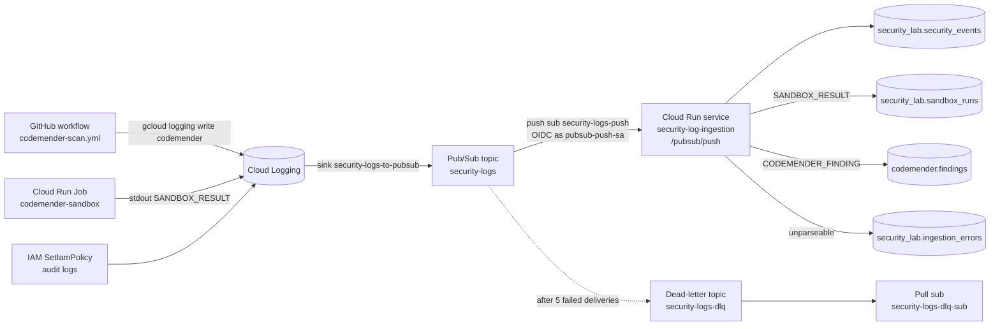

# Module 05: Log ingestion pipeline

**Goal:** Route CodeMender, sandbox, and IAM audit log entries from Cloud Logging into BigQuery through Pub/Sub and a Cloud Run service. You will finish the parser, deploy it, send test events, and test the error paths.

**Time:** 45 minutes

**Prerequisites:**
- Module 04 done (you have at least two `SANDBOX_RESULT` log entries).
- Terraform applied: Pub/Sub topics, subscriptions, the log sink, and the `security_lab` dataset exist.
- Python 3.13 locally.

```bash
export GCP_PROJECT_ID=your-gcp-project-id
export REGION=us-central1
```

---

## Flow



Sink filter for `security-logs-to-pubsub`:

```
logName:"logs/codemender"
OR (resource.type="cloud_run_job" AND resource.labels.job_name="codemender-sandbox" AND jsonPayload.event_type="SANDBOX_RESULT")
OR (protoPayload.methodName="SetIamPolicy" AND logName:"cloudaudit.googleapis.com%2Factivity")
```

Response rules in `log-ingestion/main.py`:

| Case | Writes to | HTTP response | Pub/Sub behavior |
|---|---|---|---|
| Parsed OK | `security_events` (+ `sandbox_runs` or `codemender.findings`) | 2xx | ack |
| Unparseable message | `ingestion_errors` | 2xx | ack (no retry storm) |
| BigQuery transient failure | nothing | 500 | retry; after 5 attempts, dead-letter to `security-logs-dlq` |

---

## Schema walkthrough

Canonical schemas live in `infra/terraform/schemas/<table>.json`. `log-ingestion/schema/` holds identical copies plus `ddl.sql`.

**`security_lab.security_events`**: one row per log entry. Partitioned by `DATE(event_timestamp)`, clustered by `event_type, severity`.

| Column | Type | Source |
|---|---|---|
| `insert_id` | STRING REQUIRED | LogEntry `insertId` (dedupe key) |
| `event_timestamp` | TIMESTAMP REQUIRED | LogEntry `timestamp` |
| `ingest_timestamp` | TIMESTAMP REQUIRED | time of insert |
| `event_type` | STRING REQUIRED | `CODEMENDER_SCAN_STARTED`, `CODEMENDER_SCAN_COMPLETED`, `CODEMENDER_FINDING`, `CODEMENDER_PATCH`, `SANDBOX_RESULT`, `IAM_POLICY_CHANGE`, `OTHER_SECURITY` |
| `source` | STRING | `codemender`, `sandbox`, `cloud_audit` |
| `severity` | STRING | payload severity or LogEntry severity |
| `project_id`, `resource_type`, `resource_name` | STRING | LogEntry resource |
| `principal` | STRING | audit log `authenticationInfo.principalEmail` |
| `repository`, `commit_sha`, `issue_id`, `session_id`, `run_id`, `status` | STRING | jsonPayload fields |
| `summary` | STRING | short human-readable line |
| `log_name` | STRING | LogEntry `logName` |
| `raw_payload` | STRING | full payload as JSON text |

**`security_lab.sandbox_runs`**: one row per `SANDBOX_RESULT`. Columns: `run_id`, `execution_name`, `repository`, `commit_sha`, `patch_ref`, `issue_id`, `poc_test`, `started_at`, `finished_at`, `poc_before`, `poc_after`, `patch_applied`, `unit_tests_passed`, `tests_total`, `tests_failed`, `verdict`, `log_excerpt`.

**`codemender.findings`**: the existing table read by the existing MCP tools. `CODEMENDER_FINDING` events add rows here (`finding_id`, `issue_id`, `repository`, `file_path`, `line_number`, `cwe_id`, `severity`, `status`, `wiz_issue_id`, `created_at`, ...).

**`security_lab.ingestion_errors`**: `received_at`, `message_id`, `insert_id`, `error`, `raw_message`.

---

## Steps

### 1. Complete the parser TODOs (12 min)

Complete the TODOs in `starter/log-ingestion/parser.py`, or copy the solution from `log-ingestion/parser.py` if you fall behind.

The TODOs cover:

1. Decode the Pub/Sub push envelope: `message.data` is base64; the decoded bytes are a LogEntry JSON.
2. Classify `event_type`:
   - `logName` ends with `/logs/codemender` -> use `jsonPayload.event_type` (`CODEMENDER_*`), `source=codemender`.
   - `resource.type == "cloud_run_job"` and `jsonPayload.event_type == "SANDBOX_RESULT"` -> `SANDBOX_RESULT`, `source=sandbox`.
   - `protoPayload.methodName == "SetIamPolicy"` -> `IAM_POLICY_CHANGE`, `source=cloud_audit`, `principal` from `protoPayload.authenticationInfo.principalEmail`.
   - anything else -> `OTHER_SECURITY`.
3. Build the `security_events` row with `insert_id = insertId`.
4. For `SANDBOX_RESULT`, also build a `sandbox_runs` row. For `CODEMENDER_FINDING`, also build a `codemender.findings` row.
5. Raise the parser's parse error type on invalid input so `main.py` writes to `ingestion_errors`.

To work on the starter copy, copy it over the solution file in a scratch clone, or point the tests at it (see the comment at the top of `starter/log-ingestion/parser.py`; confirm in your environment).

### 2. Run unit tests (3 min)

```bash
cd log-ingestion
PYTHONDONTWRITEBYTECODE=1 python3 -m unittest discover -s tests -v
```

Expected: all tests `ok`, ending with:

```
----------------------------------------------------------------------
Ran N tests in 0.0XXs

OK
```

The tests stub `google.cloud.bigquery` through `sys.modules`, so no Google client libraries are needed locally.

### 3. Deploy (7 min)

```bash
cd log-ingestion
./deploy.sh
```

This builds image `security-log-ingestion` into Artifact Registry repo `security-lab` and deploys Cloud Run service `security-log-ingestion` as `log-ingestion-sa`, with no unauthenticated access.

Verify:

```bash
gcloud run services describe security-log-ingestion --region="$REGION" \
  --format="value(status.url,spec.template.spec.serviceAccountName)"
gcloud run services get-iam-policy security-log-ingestion --region="$REGION" \
  --format="table(bindings.role,bindings.members)"
```

Expected: a `https://security-log-ingestion-...run.app` URL, `log-ingestion-sa@...`, and `roles/run.invoker` bound to `serviceAccount:pubsub-push-sa@your-gcp-project-id.iam.gserviceaccount.com`. `allUsers` must not appear.

### 4. Verify the sink, push subscription and DLQ (5 min)

Terraform created these. Confirm:

```bash
gcloud logging sinks describe security-logs-to-pubsub \
  --format="value(destination,filter,writerIdentity)"
```

Expected: destination `pubsub.googleapis.com/projects/your-gcp-project-id/topics/security-logs`, the filter shown above, and a writer identity. The writer identity needs `roles/pubsub.publisher` on the topic:

```bash
gcloud pubsub topics get-iam-policy security-logs
```

```bash
gcloud pubsub subscriptions describe security-logs-push \
  --format="yaml(pushConfig,deadLetterPolicy,ackDeadlineSeconds)"
```

Expected:

```yaml
deadLetterPolicy:
  deadLetterTopic: projects/your-gcp-project-id/topics/security-logs-dlq
  maxDeliveryAttempts: 5
pushConfig:
  oidcToken:
    serviceAccountEmail: pubsub-push-sa@your-gcp-project-id.iam.gserviceaccount.com
  pushEndpoint: https://security-log-ingestion-....run.app/pubsub/push
```

```bash
gcloud pubsub subscriptions describe security-logs-dlq-sub --format="value(topic)"
```

Expected: `projects/your-gcp-project-id/topics/security-logs-dlq`.

Dead-lettering also needs the Pub/Sub service agent (`service-<PROJECT_NUMBER>@gcp-sa-pubsub.iam.gserviceaccount.com`) to have publisher on `security-logs-dlq` and subscriber on `security-logs-push`. Terraform grants this; confirm in your environment.

### 5. Send test events (3 min)

```bash
cd seed-data
./write_sample_logs.sh
```

The script writes sample `codemender` entries from `seed-data/log_entries/` with `gcloud logging write codemender '<json>' --payload-type=json`. Wait about 60 seconds for the sink and push delivery.

Watch the service log:

```bash
gcloud logging read \
  'resource.type="cloud_run_revision" AND resource.labels.service_name="security-log-ingestion"' \
  --limit=20 --freshness=10m --format="value(timestamp,httpRequest.status,textPayload)"
```

Expected: `POST /pubsub/push` requests with status 200 or 204.

### 6. Query BigQuery to confirm (3 min)

```bash
bq query --use_legacy_sql=false '
SELECT event_type, source, COUNT(*) AS n, MAX(event_timestamp) AS latest
FROM `your-gcp-project-id.security_lab.security_events`
WHERE DATE(event_timestamp) >= DATE_SUB(CURRENT_DATE(), INTERVAL 1 DAY)
GROUP BY event_type, source
ORDER BY n DESC'
```

Expected: rows for `CODEMENDER_*` with `source=codemender`, and `SANDBOX_RESULT` with `source=sandbox` (from Module 04).

```bash
bq query --use_legacy_sql=false '
SELECT run_id, issue_id, poc_before, poc_after, patch_applied, unit_tests_passed, verdict
FROM `your-gcp-project-id.security_lab.sandbox_runs`
ORDER BY finished_at DESC
LIMIT 5'
```

Expected: your Module 04 runs, with `PATCH_VERIFIED` (reference patch) and `PATCH_FAILED` (`none`).

```bash
bq query --use_legacy_sql=false '
SELECT finding_id, issue_id, file_path, cwe_id, severity, status, wiz_issue_id
FROM `your-gcp-project-id.codemender.findings`
WHERE DATE(created_at) >= DATE_SUB(CURRENT_DATE(), INTERVAL 1 DAY)
ORDER BY created_at DESC
LIMIT 10'
```

Expected: findings from the sample log entries (for example `CM-0001`, `app/db.py`, `CWE-89`).

### 7. Dead-letter tests (7 min)

**Malformed message -> `ingestion_errors`, no retry.**

```bash
gcloud pubsub topics publish security-logs --message='this is not a LogEntry {'
```

After about 30 seconds:

```bash
bq query --use_legacy_sql=false '
SELECT received_at, message_id, error, SUBSTR(raw_message, 1, 80) AS raw
FROM `your-gcp-project-id.security_lab.ingestion_errors`
ORDER BY received_at DESC
LIMIT 5'
```

Expected: one row with your text in `raw` and a JSON decode error in `error`. The service returned 2xx, so Pub/Sub does not redeliver it.

**Forced 500 -> DLQ after 5 attempts.**

Point the service at a dataset that does not exist so every insert fails:

```bash
gcloud run services update security-log-ingestion --region="$REGION" \
  --update-env-vars=SECURITY_DATASET=does_not_exist
cd seed-data && ./write_sample_logs.sh
```

This relies on `bq_writer.py` returning 500 when the insert fails. Check how it classifies "not found" errors (confirm in your environment). With the default retry backoff, five attempts take a few minutes. Then pull from the DLQ:

```bash
gcloud pubsub subscriptions pull security-logs-dlq-sub --limit=5 --auto-ack \
  --format="table(message.messageId,message.attributes)"
```

Expected: the messages, with attributes such as `CloudPubSubDeadLetterSourceDeliveryCount=5`.

Restore the service:

```bash
gcloud run services update security-log-ingestion --region="$REGION" \
  --update-env-vars=SECURITY_DATASET=security_lab
```

### 8. Dedupe check (2 min)

Pub/Sub delivers at least once, so duplicates can arrive. `insert_id` is the dedupe key. Check for duplicates:

```bash
bq query --use_legacy_sql=false '
SELECT insert_id, COUNT(*) AS copies
FROM `your-gcp-project-id.security_lab.security_events`
WHERE DATE(event_timestamp) >= DATE_SUB(CURRENT_DATE(), INTERVAL 7 DAY)
GROUP BY insert_id
HAVING COUNT(*) > 1
ORDER BY copies DESC
LIMIT 20'
```

Expected: no rows, or a few. Streaming-insert dedupe on `insertId` is best effort, so readers should dedupe at query time:

```sql
SELECT * EXCEPT(rn) FROM (
  SELECT *, ROW_NUMBER() OVER (PARTITION BY insert_id ORDER BY ingest_timestamp) AS rn
  FROM `your-gcp-project-id.security_lab.security_events`
  WHERE DATE(event_timestamp) >= DATE_SUB(CURRENT_DATE(), INTERVAL 7 DAY)
) WHERE rn = 1
```

---

## Check your work

- [ ] Parser unit tests pass.
- [ ] `security-log-ingestion` is deployed; only `pubsub-push-sa` can invoke it.
- [ ] Sink, push subscription (OIDC, `/pubsub/push`), DLQ topic and DLQ pull subscription confirmed, with `maxDeliveryAttempts: 5`.
- [ ] `security_events`, `sandbox_runs` and `codemender.findings` have new rows.
- [ ] Malformed message produced an `ingestion_errors` row.
- [ ] Forced failure ended up in `security-logs-dlq-sub`; the service env var is restored.
- [ ] Dedupe query ran.

## Troubleshooting pointers

See [troubleshooting.md](troubleshooting.md#log-ingestion) for push 403, messages piling up in the DLQ, and schema mismatch errors in `ingestion_errors`.

## What you built

- A log pipeline: Cloud Logging sink -> Pub/Sub push (OIDC) -> Cloud Run -> BigQuery.
- Safe failure handling: bad input is recorded and acknowledged; transient failures retry and then dead-letter.
- Queryable tables (`security_events`, `sandbox_runs`) that the agent's MCP tools read in Modules 06-08.
